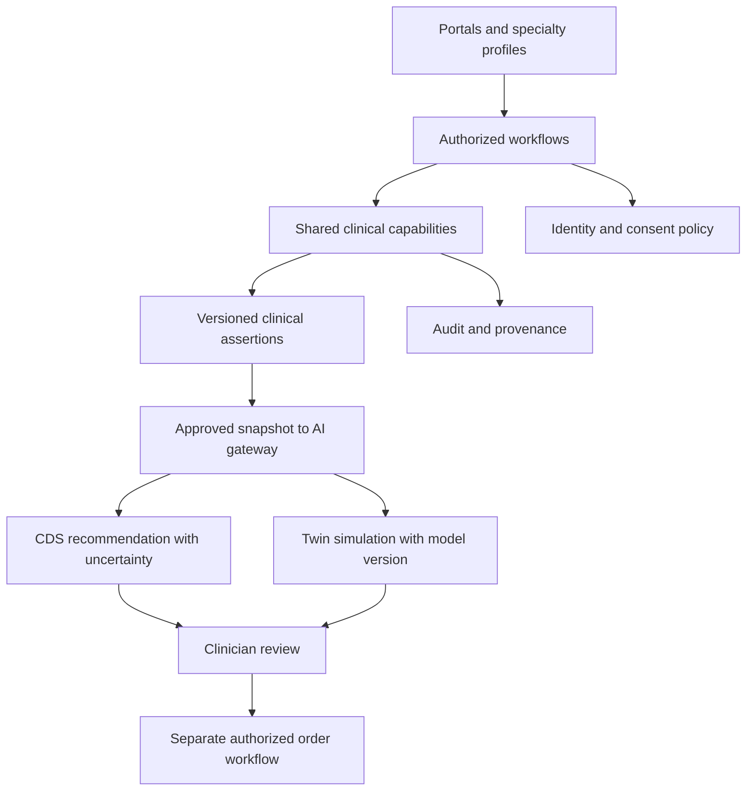

# Canonical architecture — proposal 01

Это проект нормализации, а не утверждённая архитектура всех 5175 модулей. Реестр владельцев: [canonical_owners.json](canonical_owners.json). Каждая запись CAP — логическая ответственность, не новый historical module_id и не требование отдельного микросервиса. Оригинал и существующие P0 specifications остаются доступными; APPLY выключен.

## Иерархия ответственности

| Слой | Ответственность | Правило зависимости |
|---|---|---|
| PLATFORM CORE | Identity, policy enforcement, audit/provenance, tenant/data governance, operations | Не зависит от specialty UI |
| SHARED CAPABILITY | Medication, eRx, pharmacy, lab, imaging, documents, scheduling, notifications, telemedicine, devices, interoperability, AI/twin core | Один владелец каждого факта/жизненного цикла |
| DOMAIN CORE | Passport, encounters, travel, research | Оркестрирует shared owners; не копирует их authoritative records |
| SPECIALTY PROFILE | Терминология, наборы данных, eligibility, клинические ограничения | Версионированный profile ID + ограничения поверх shared contracts |
| WORKFLOW | Приём, согласование, disclosure, handover | Машина состояний с человеком/системой, ошибками и audit |
| UI / PORTAL | Patient/clinician/guardian/research views | Permission-filtered проекции, без собственного источника фактов |
| AI / CDS PROFILE | Intended use, cohort, thresholds, recommendations | Model gateway + separate evaluation + human decision |
| DIGITAL TWIN PROJECTION | Орган/болезнь/ответ на лечение/прогноз | Версионированный snapshot, модель и scenario; выход остаётся simulation |

Стрелки диаграммы показывают поток данных/действий. В JSON graph ребро означает dependent → prerequisite; эти направления не нужно смешивать. Audit записывается для каждой привилегированной операции, а не только для показанных стрелок.

## Проверенные примеры нормализации

- 8/13/57: catalog и reported medication use → CAP-MEDICATION; order → CAP-PRESCRIPTION; dispense → CAP-PHARMACY; witnessed administration → CAP-ADMINISTRATION. Общая связь с пациентом не делает эти записи одним фактом.
- 30/227/1924: schema, patient controls и dynamic/cross-border requirements → CAP-CONSENT с отдельными workflow/profile specs. AI не владеет решением об авторизации.
- 61/4595: CAP-INTEROP и pediatric renal exchange profile. Dialysis/transplant/pathology, handover и freshness сохраняются как профильные требования.
- 1681/1700: один twin runtime и composition contract; 1683–1686 — семейства моделей, 2030/2069 — specialty projections. 1697/1698 имеют research context, 1699 — clinician CDS presentation.
- 1003/1073/1093: общий scheduling, отдельная specialty eligibility. 2220/2590: объединять только после сохранения surgery/telemedicine и genetics/lab.

## Границы хранения и исполнения

Начальная реализация — модульный сервер, PostgreSQL и закрытое object storage согласно существующему P0. Владение таблицами закрепляется за capability; другим модулям запрещены прямые записи в чужие таблицы. Межмодульные команды проходят policy check и version precondition. CAP-SPECIALTY — временная корзина профильных предложений, а не единый универсальный клинический сервис: ей нужны конкретные specialty owners и profiles.

В одной транзакции: изменение authoritative record + outbox event + минимальная audit reference. Consumers должны быть идемпотентны по event_id и resource_version. Старое событие не откатывает более новую версию. Медицинский payload не дублируется в общей шине/logs: передаётся разрешённая ссылка с subject/tenant/version и минимально необходимыми метаданными. Dead-letter очередь и повторная выдача также подчиняются privacy policy.

Read models хранят source_version и generated_at. После исправления/отзыва меняется projection version; stale read не выдаётся как актуальный medical snapshot. При policy service unavailable доступ к закрытым данным закрыт; отдельный break-glass workflow нельзя имитировать fallback-ролью.

## Критические контракты для следующего прохода

| Контракт | Инвариант | Нужное доказательство |
|---|---|---|
| Identity → patient binding | Не связывать аккаунты только по имени/дате рождения | collision/merge/unmerge cases, проверка tenant isolation |
| Consent → QR redemption | Политика проверена на момент одного атомарного redemption | concurrent redeem/revoke/expiry тесты |
| Data → specialty summary | Факт имеет один owner, version и truth kind | cross-specialty correction и stale cache тест |
| Documents → OCR/AI | Производная не меняет источник и его verification | quarantined/malicious file, mismatch version тест |
| AI/twin → clinical order | Нельзя выдать order без отдельного authorized actor/action | direct write denial, approval replay, stale snapshot тест |
| Interop → data | Uncertain matching/mapping quarantined | incompatible profile, ambiguous identifier, unknown code tests |

Граф CAP проверен на существование узлов и циклы. Это не проверка работоспособности контрактов: critical_dependencies_verified = 0. Полнота всего графа не доказана; source mentions и предложенные edges хранятся раздельно в [dependency_graph.json](dependency_graph.json).
