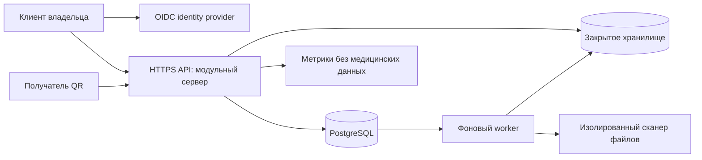

# Архитектура P0: медицинский паспорт EDHT

Статус: **proposed-specification**, 12 сентября 2026. Это проект решения, а не описание работающего сервиса. Исходные модули: 2–5, 51–54, 81–84, 89. Контракт: [OpenAPI](../../specs/openapi.json).

## Граница первого релиза

Один совершеннолетний пользователь ведёт собственный паспорт: краткий профиль, аллергии, самостоятельно внесённый список лекарств и медицинские документы. Он явно выбирает разделы для ограниченного по времени QR-доступа и видит историю операций. Сведения пользователя не считаются подтверждёнными врачом. EDHT в этом релизе не назначает лечение, не проверяет совместимость лекарств и не гарантирует пригодность паспорта для клинического решения.

P0 не включает опекунство, детские профили, роли медицинских организаций, страхование, SOS-диспетчеризацию, электронные рецепты, машинный перевод медицинских сведений, AI, автоматическую интеграцию с больницами или работу QR без сети. Добавление этих функций требует отдельной спецификации, модели доступа и проверки применимости нормативных требований. Наличие модуля в каталоге 5 175 идей не означает включение в релиз.

## Решение ADR-001

Один модульный сервер, PostgreSQL и закрытое объектное хранилище. Фоновый worker собирается из того же исходного проекта и выполняет проверку документов, экспорт и удаление. Внешний поставщик идентификации выполняет OIDC-вход. Язык и фреймворк сервера пока не выбраны; репозиторий содержит проверяемые контракты, а не фиктивную реализацию.

Границы модулей сервера:

| Модуль | Ответственность | Исходные ID |
|---|---|---|
| Identity | Проверка access token, локальное состояние аккаунта и сессии | 6, 29, 54, 81, 82 |
| Passport | Профиль, аллергии, лекарства, версии записей | 7, 8, 10, 56, 57, 59 |
| Documents | Карантин, метаданные, безопасная выдача, удаление | 12, 53 |
| Sharing | Согласия, QR grants, отзыв и атомарное использование | 14, 30, 32, 33 |
| Audit | Минимальные события чтения, изменения и отказов | 27, 83 |
| Lifecycle | Экспорт, удаление, восстановление и retention | 55, 84, 89 |

Каждый модуль владеет своими таблицами. Межмодульная операция выполняется через сервисный интерфейс; критические изменения состояния и запись аудита находятся в одной транзакции PostgreSQL. Медицинские данные не передаются во внешнюю аналитику. События для worker записываются в transactional outbox, worker обеспечивает повторную доставку и идемпотентное выполнение по `job_id`. Очередь и Redis не являются обязательными зависимостями P0. Выделение микросервиса допустимо после измеренной необходимости и отдельного ADR.

## Изоляция и целостность

Для владельца субъект определяется из проверенного токена, а не из `user_id` тела запроса. UUID ресурса не является разрешением. Все чтения и записи ограничены владельцем. Внешние IDs и `storage_key` не позволяют обойти это ограничение. Чужой и отсутствующий ресурс возвращают одинаковый 404.

В качестве дополнительной защиты проектируется PostgreSQL Row Level Security. При использовании RLS runtime-роль не владеет таблицами и не имеет `BYPASSRLS`; транзакционный контекст субъекта устанавливается сервером и сбрасывается до возврата соединения в пул. Миграции исполняются отдельной ролью. Владелец таблицы и superuser могут обходить RLS, поэтому одной декларации RLS недостаточно. [Документация PostgreSQL](https://www.postgresql.org/docs/18/ddl-rowsecurity.html).

В P0 нет административной роли с повседневным доступом к медицинскому содержимому. Техническая поддержка видит служебные IDs и состояние задания. Разовый привилегированный доступ в инциденте требует отдельного ограниченного разрешения, регистрации и последующей проверки; интерфейс такого доступа в P0 не опубликован.

## Измеримые проектные цели

Все значения ниже — предлагаемые цели приёмки, **не результаты замеров и не SLA**. Базовый стенд: 10 000 синтетических владельцев, до 100 активных аллергий и 100 активных лекарств на паспорт, 50 запросов/с в течение 30 минут; 90% чтение, 10% запись. Загрузка и скачивание файлов тестируются отдельно.

| Свойство | Цель | Как проверять |
|---|---|---|
| JSON API | p95 ≤ 500 мс, p99 ≤ 1 500 мс | Замер на входе API; ошибки включены, прогрев отдельно |
| QR resolve | p95 ≤ 700 мс; при отказе зависимостей данные не выдаются | 20 параллельных предъявлений одного токена: ровно один успех |
| Доступность | ≥99,5% за календарный месяц | Успех синтетического сценария profile-read раз в минуту; плановые остановки учитываются |
| Отзыв доступа | Первый запрос после commit отзыва получает отказ | Гонка revoke/resolve; отсутствие положительного кеша разрешений |
| Восстановление | RPO ≤24 ч; RTO ≤8 ч для pilot | Полное восстановление из независимой резервной копии |
| Документы | Файл ≤20 MiB, PDF/JPEG/PNG | Граничные размеры, подмена MIME, вредоносный и повреждённый файл |
| Аудит | 100% успешных медицинских чтений/изменений имеют event_id | Сопоставление синтетических запросов и событий |
| Доступность интерфейса | Основной сценарий доступен с клавиатуры и экранным диктором | Ручная проверка входа, профиля, согласия и отзыва |

Усиленные цели исходного модуля 84 (RTO 15 мин, RPO 5 мин) сохраняются как кандидат для следующего этапа. Они требуют выбранной инфраструктуры, непрерывного архивирования, отдельного бюджета и подтверждённого восстановления. Обещание «Zero Data Loss» исключается.

## Приёмка перед реальными медицинскими данными

Обязательны работающая реализация и интеграционные тесты всех инвариантов, проверка объекта хранения на закрытый доступ, тест отказов сканера/БД/аудита, нагрузочная проверка указанных целей, независимое восстановление и проверка удаления. Применимая юрисдикция, операторы обработки, сроки хранения и разрешённые категории пользователей должны быть установлены владельцем продукта до пилота. Стандарты безопасности и законодательства в исходнике — области проверки, а не сертификаты продукта.
